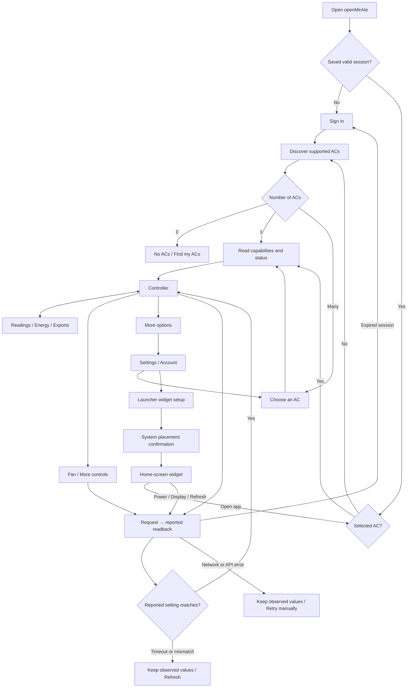

# openMirAIe · Complete interaction handoff

Status: proposed design and simulated prototype, 19 October 2026. This extends the approved playful native Android direction. It does not change the installed app, call MirAIe, save credentials, or authorize publishing. Use `../prototype/index.html` for the clickable prototype, `../prototype/map.html` for the journey map, and `../explorations/stitch-flows/` for supplementary Stitch visual boards. Production target: a new native Android app, followed by native iOS and macOS apps. The current Java/RemoteViews app is a PoC and behavioral reference, not the production codebase. Reuse verified protocol behavior; choose production libraries, persistence and secure storage within each platform project.

## 1. Entry and navigation

Bottom navigation contains Controller and Readings. Switching tabs preserves unsent temperature/mode drafts and scroll position per tab. Android Back dismisses a sheet first, then returns from Settings/device picker to Controller; from Controller it backgrounds the app. Navigating away never sends an unsent draft. Selecting a different AC or signing out prompts to discard drafts. System Back from sign-in may background the app.

The room title/chevron opens the AC picker. More options opens Settings, Choose another AC, Add widget and Device details. Device picker cancellation returns to the previous selected AC. A one-device discovery selects it automatically; multiple devices require selection. All widget actions use the currently selected AC, not an independently remembered device.

## 2. First-use and account flow

| Interaction | Behavior and recovery |
|---|---|
| Sign-in fields | Mobile/email, password, keyboard Next/Done, platform autofill, Show/Hide with accessible labels. Never log or put credentials in diagnostics. Prototype uses synthetic prefilled values only. |
| Empty fields | Validate inline, focus first invalid field, retain the identity. Do not request sign-in until both are present. |
| Sign in | Disable duplicate submission; show Signing in. Clear transient password after sending; use existing secure-session storage. Success discovers devices. |
| Invalid credentials/network | Inline actionable error; re-enable form. Retain identity, clear password in native app after attempt. No account-lockout bypass or automatic retry. |
| Forgot password | Explain that reset happens through Panasonic MirAIe, then return to sign-in. No invented reset/registration endpoint. |
| No ACs | Empty screen, Find my ACs and Sign out. Explain account/setup must be checked in MirAIe. No invented device-pairing wizard. |
| Select AC | Clear old-device readings from view immediately, show Loading, then read this AC’s capabilities/status. Never show another AC’s values under the new name. |
| Session expires | Cancel unsent drafts, clear sensitive session, show Sign in again; preserve selected-device identity as permitted by existing session handling, and local snapshot storage. Never replay a command after sign-in. |
| Sign out | Confirm; remove account session, blank account-bound current values, update widgets to Sign in. Local snapshots remain in app storage, consistent with current behavior; disclose this. No unimplemented delete/export-all flow is implied. |

## 3. Reported state, drafts and requests

There are three distinct values: the latest reported value, the user’s draft, and any pending request. A draft is never displayed as reported. A successful HTTP response means accepted, not physical confirmation. Matching cloud-reported readback permits “AC reports the updated setting,” not a claim that the physical mechanism has been independently measured.

| State | Presentation | Allowed actions |
|---|---|---|
| Initial loading, no cache | Skeletons or em dashes; no fabricated 23°C default | Navigation, sign-out, retry after load ends |
| Loaded | Actual reported values and last-read timestamp | Capability-supported actions |
| Refreshing with cache | Retain values; Updating label | Navigation; prevent duplicate reads/writes |
| Local draft | Selected target/mode plus separate reported value; explicit Set/Apply | Reset draft; commit if allowed |
| Sending | “Sending change…”; keep reported value and describe requested value | Navigation allowed; device changes/sign-out blocked until completion |
| Verifying | “Checking reported state…”; retain last read | No conflicting commands, no duplicate submissions |
| Matched readback | Update observed value and timestamp; short confirmation | Normal controls |
| Accepted, unconfirmed | “Change sent; AC hasn’t reported it yet. Refresh to check.” Preserve observed value and visible intended value | Manual Refresh, dismiss; no automatic command resend |
| Request failed | Error; preserve last-known values. A transport failure may occur after delivery, so do not assert nothing changed | Refresh first; user may explicitly retry after inspecting state |
| Phone offline | “No internet connection. Last-known values are shown.” Timestamp remains old | Navigation, manual retry; no queued/replayed writes |
| AC offline | Offline badge; retain clearly dated last-known values | Refresh; disable AC writes until a fresh online report |
| Missing field | “Not reported” or unavailable, never zero or fabricated value | Refresh; disable a toggle whose current value is unknown |
| Capabilities unavailable | Informative message; disable dependent controls | Refresh capabilities; retain independently known safe controls |

Native timing reuses bounded existing readback checks rather than inventing an arbitrary success delay. Prototype delays are accelerated and synthetic. After app recreation/process death, re-read observed values; never replay pending writes. Preserve drafts across native configuration changes, but do not persist a pending action as a command queue. When a fresh read conflicts with a draft, retain the draft with the new “AC reports…” value and require explicit Set again.

## 4. Controller interaction matrix

| Control | Draft/commit behavior | Rules |
|---|---|---|
| Refresh icon / status refresh | Read status/capabilities as appropriate; save a selected-device snapshot; update timestamp on successful read | Preserve local drafts; retain cache and old timestamp on error. Two entry points perform the same action. |
| Temperature −/+ | Select 16–30°C, 1°C steps; big numeral becomes Selected target; show “AC reports 23°C” separately | No network request. Clamp at bounds and disable bound button. Set disabled when unchanged. |
| Set target | Send chosen target and verify readback | Power on, applied non-Fan mode, cleaning off, no in-flight command. On failure retain draft and observed value separately. Reset returns to reported value. |
| Mode Auto/Cool/Dry/Fan | Selecting marks a draft; Active mode remains reported. Explicit Apply sends it | Discard confirmation if a temperature draft would be reset. Temperature/fan remain disabled until chosen mode matches reported mode. Selecting active mode cancels mode draft. |
| Apply mode | Send selected mode, then reload dependent capabilities/ranges from reported state | No Heat on known model. Hide unsupported modes on other devices. Do not force fan Low in Dry. |
| AC power switch | Direct explicit request on tap, after draft-discard confirmation when needed | Independent of display. Show observed On/Off until verified. Off disables mode/temp/fan, without implying room temperature unavailable. |
| AC display switch | Direct display-only request; verify independently | Works while AC power is off when reported support permits. Unknown display state disables toggle and offers refresh. Not an alias for power. |
| Fan row | Opens selection sheet with reported current fan and draft radio selection | Auto, Quiet, Low, Medium, High. Set fan disabled until changed; Cancel/Back discards sheet draft. |
| More controls | Open sheet containing reported Eco/Powerful states and capacity choices | Sheet entry may remain available while controls are restricted so the reason is readable. No cleaning, Swing, timer or nanoe action is invented. |
| Room reading | Read-only current sample from latest report | Fractional precision allowed; unavailable when absent. No gesture implies a live sensor stream. |

Native switches use standard Android geometry with at least 48dp clickable bounds. There is no secondary confirmation for ordinary power/display toggles. Confirmations are reserved for discarding drafts and material coupled effects below.

## 5. Mode-dependent layouts and secondary sheets

| Reported condition | Temperature | Fan | Eco / Powerful / capacity |
|---|---|---|---|
| Cool, powered on | Range and Set | Advertised choices | Eco/Powerful enabled subject to cleaning; capacity follows advertised capability |
| Auto, powered on | Device-advertised range | Advertised choices | Eco/Powerful unavailable with explanation; capacity only if capability permits |
| Dry, powered on | Device-advertised range | Disabled, “Dry manages fan automatically” | Eco/Powerful disabled; capacity follows capabilities |
| Fan-only, powered on | Hidden; show “Just a breeze. No target temperature.” | Advertised choices | Eco/Powerful disabled; no fake target value on widget |
| Power off | Disabled | Disabled | Power-gated; display remains independent |
| Cleaning active | Disabled with reason | Disabled with reason | Powerful disabled. Cleaning is reported only; Eco/capacity follow actual capability/current app rules |
| Selected mode not yet applied | Disabled | Disabled | Avoid committing settings against a different mode; resolve draft first |

Fan sheet: radio list, reported/current marker, explicit Set fan, Cancel, Back/outside-tap dismissal. A sheet draft is local and never sends on dismissal.

Eco: Off → tap Enable → confirmation “Eco will set target to 26°C” → Cancel or Enable Eco → sequence enable Eco and set target, verifying each effect. If only part confirms, show observed values for each with an unconfirmed note; do not claim full completion. Turning Eco off uses a direct command and does not invent restoration of the previous target.

Powerful: enabling with fixed capacity shows “This resets capacity to Normal.” Confirm → disable fixed capacity, verify, then enable Powerful and verify. Otherwise direct request. Disabling Powerful does not restore old fixed capacity automatically. Cleaning disables Powerful.

Capacity: choose Normal (0), 40/50/60/70/80/90/100/110%; Set disabled until changed. With Powerful on, confirm “Setting fixed capacity turns Powerful off.” Cancel keeps draft; Set disables Powerful and verifies before setting capacity. Never show 55%, infer measured power, or auto-enable a previous setting. Partial sequence failure leaves actual reported state visible.

Dismiss sheets with Close, Back or outside tap. Focus returns to originating control; keyboard focus remains trapped while a modal is open. Destructive or coupled-action confirmation cancellation performs no network request.

## 6. Readings, energy, diagnostics and exports

Readings contains room temperature, fan setting, power/display, online status and observation timestamp; measured RPM/humidity/compressor frequency explicitly unavailable for known AC. Do not invent sensors from an API schema alone. Device details includes reported RSSI, warnings/errors and optional fields only when actually present, preserving units and source meanings.

Energy starts Not loaded. Load recent energy queries current seven-day history and shows returned daily kWh rows, reported-entry total and date range. Today is marked partial. Display missing days as missing, never zero-filled or silently interpolated. Empty, loading, failed and previously-loaded-but-stale states are distinct. Retain previous energy result on reload failure with its original load time. No continuous chart or background polling is promised.

Snapshots count is selected-device-specific; storage limit is 5,000 records globally. Recording happens through existing manual refresh/command/widget readbacks, not a continuous logger. Native app retains current behavior for diagnostic read paths and surfaces recording failure separately from successful device readback.

| Action | Destination / result |
|---|---|
| Export readings | Enabled for available selected-device snapshots; Android CREATE_DOCUMENT, readings CSV filename. Cancel does nothing. Confirm success only after actual write completes. Picker/write permission/storage errors show retry without losing data. |
| Export energy | Enabled only after energy entries loaded; separate energy CSV file and picker. Same cancel/write-error behavior. No confusing energy with reading snapshots. |
| All reported fields | Read-only advanced sheet, sorted fields, scrollable/selectable text; unknown values not interpreted as sensors |
| Refresh capabilities | Busy → reload supported controls; on failure retain known profile with warning, never replace it with empty invented defaults |
| Collect diagnostic snapshot | Existing inspect operation collects redacted JSON inside app-private/external-app storage; show collected or failure. No invented share/upload/system JSON export action |

The web prototype’s sample CSV download stands in for Android’s file picker. It contains synthetic values. Native file-picker cancellation and write failures are specified here rather than faked as completed saves in the browser.

## 7. Launcher widgets

Settings → Add widget → choose Compact/Wide → Android launcher placement confirmation → widget. Cancel returns without an added widget. If pin request unsupported, explain long-press home screen → Widgets → openMirAIe. Launcher decides placement and actual cell dimensions; adding from app is not silently guaranteed.

Compact: room header/body opens selected controller; read-only target/mode/state/time; explicit On or Off action and Refresh. Wide adds fractional room reading and independent Display On/Off. Display action is new proposed widget work, already supported in main app. Fan-only hides temperature in both.

Minimum action bounds 48dp, adaptive RemoteViews layouts by available bounds, compact layout removes secondary text before shrinking actions. Prototype compact specimen is 180×180 logical pixels; “2×2” is a target-cell description, not universal launcher geometry. Verify native layouts at minimum supported bounds and large text. Offer resize guidance if usable actions cannot fit; never clip them to force a cell claim.

Widget command → Updating while keeping prior values → confirmed reported readback or “Open app to check” error. Refresh is manual, updatePeriodMillis remains 0; widget updates from app readback and selected-device changes. Display and power remain distinct even when power is Off. Signed-out widget shows Sign in; no selected AC shows Choose AC; missing display disables its action; stale/offline widgets retain timestamp and open-app recovery. Never leave another account’s cached state after sign-out. No command is queued for later.

## 8. Settings, presentation and accessibility

System appearance Light/Dark, Android system typography and local vector icons; no runtime web/font dependencies. Native app follows system appearance. Prototype allows preview toggling without implying a new persistent setting. Controller/Readings preserve status and selected AC across tabs. Every top-bar icon needs an accessible name, selected controls need text/checked semantics, errors must not rely on color, and pending announcements must not repeatedly steal focus.

48dp tap bounds, logical TalkBack order, contrast pairs from approved design system, reduced-motion support, system insets, keyboard/IME avoidance, native autofill, and 200% font scaling are native acceptance requirements. Prototype provides keyboard focus/modal trapping and a large-text review mode, but browser simulation is not native accessibility certification. Native scroll position and configuration-change restoration require implementation work.

## 9. Prototype coverage and honest limits

`../prototype/index.html` covers six journeys: controller, readings/energy, sign-in/discovery, picker, launcher widgets and settings. The left panel resets each journey to a synthetic baseline. Next request can be matching, unconfirmed, failed, phone-offline or session-expired. Edge-case controls cover Off/Dry/Fan/cleaning/missing fields/unknown display/capabilities absent/AC offline/no devices/one device/no energy/launcher pin fallback/signed-out widget/no-selected-device widget/dark/large text.

Prototype labels and timings are review tools, not app settings. Commands are simulated, sample data is fixed, some readbacks are simplified, and Android credential/file-picker/launcher interactions are represented as handoffs. No actual device/account/credential, current weather, API request, background service, or destructive data action is used. Unconfirmed partial multi-command results are defined in this handoff; native implementation must use real per-field readback and error handling. Stitch screens are supplementary static design exploration; this document and corrected local prototype take precedence over invented labels in original exports.

## 10. Implementation acceptance checklist

- Every visible app action maps to an existing API/capability or an explicitly proposed widget/navigation change.
- Every write has draft/request/reported-state separation, bounded readback and failure recovery; no queued replay or fake success.
- Mode, power and cleaning restrictions match DeviceProfile/current app rules; capacity/Eco/Powerful sequences verify partial effects.
- No account/device cache leaks across selection/sign-out; snapshots and exports use the selected device and existing storage semantics.
- Native back, process recreation, text scaling, TalkBack, insets, system dialogs, widget bounds and all disabled/selected states are verified on Android.
- No production changes, new permissions, credentials, commits or publication are implied by approving this design handoff.
